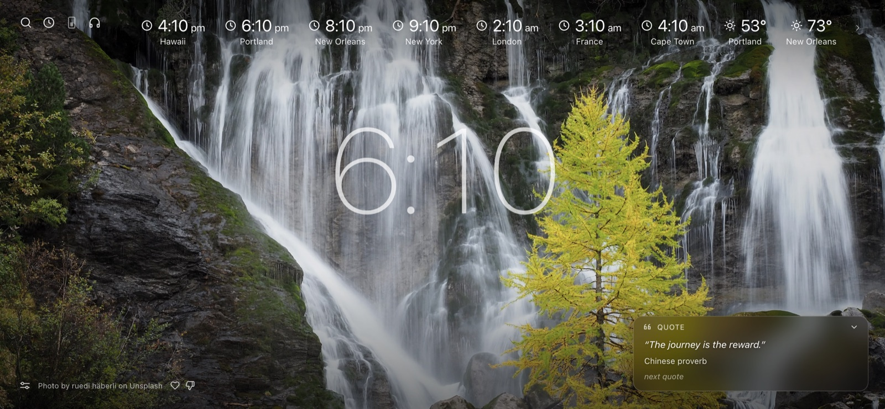
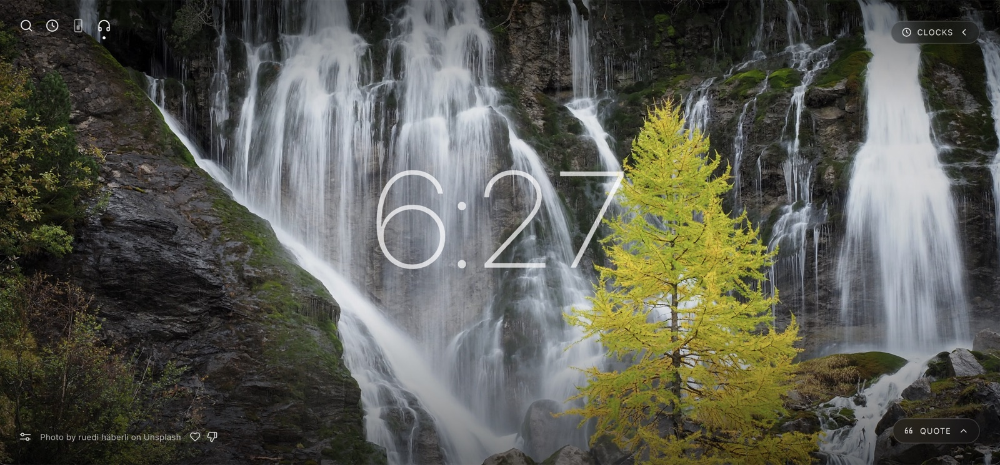
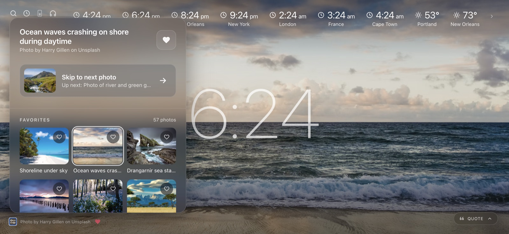
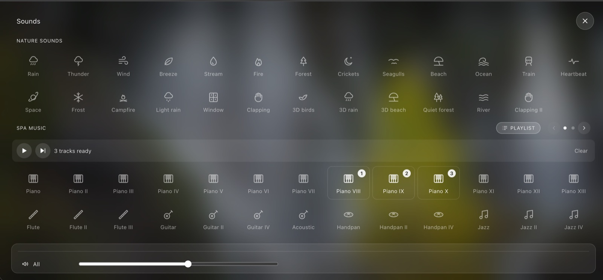

#

A light left on for you, every time you open a new tab.

Porchlight greets you with a big clock over a fresh Unsplash photo, with world clocks, weather and a daily quote close at hand. When you need a quieter moment, tap the headphones and the screen opens into a full sound mixer. Layer rain, birdsong, moving water and spa music, set each one to the level you like, or let tracks play back to back as a playlist.

It runs in any browser as your new tab page, and as an iPhone/iPad app that keeps every sound on the device, so the light stays on even offline.

With the world clocks and the quote folded away:

## What's on it

- **Clock** in the middle, with world clocks and weather along the top. The big clock (clock icon in the toolbar) and the world clocks (arrow at the end of the row) can each be hidden
- **Background photos** from Unsplash, one random photo per day from the collection in `fetch-photos.js`
- **Photo menu** (sliders icon, bottom left): the photo's title and credit, a heart to save it, *Skip to next photo* with a preview of what's next, and your favorites to pick from
- **Quote** in a glass card at the bottom right, with *next quote*; fold it down to a small pill
- **Search** (press `/`) and an optional critter
- **Sounds** (headphones icon): opens full screen. Layer nature sounds and spa music, each with its own volume slider plus one for everything. Turn on **Playlist** to play spa music tracks one after another in the order you tap them

### Music not included

Two music tiles, **Lake Marie** ("Lake Marie I" by Ian Aisling) and **Porch light** ("Leave the Porch Light On" by Cory Alstad), are from [Uppbeat](https://uppbeat.io/) and aren't in this repo, so they stay silent until you add your own. To use them or add other music, download tracks from [uppbeat.io](https://uppbeat.io/) and save them as `sounds/lakemarie.m4a` and `sounds/porchlight.m4a` (or add new tiles in `index.html`).

## Running it

No build. Open `index.html` in a browser, or set it as your new-tab / home page.

Favorites, hidden photos and settings are saved in the browser. `prefs.js` fills in starting favorites and settings the first time a browser opens the page.

## iPhone / iPad app

The same page, packaged as an app (Capacitor) with every sound stored on the device, so they play with no internet. Photos still come from Unsplash.

One-time setup: install **Xcode** from the Mac App Store and open it once.

To install on your phone or iPad:

1. Plug it into the Mac (on the device, tap **Trust**; on iOS 16+, turn on **Settings → Privacy & Security → Developer Mode**).
2. Run `npm run ios`. It copies the page and sounds into the app and opens Xcode.
3. In Xcode: click **App** in the left sidebar → **Signing & Capabilities** → **Team** → **Add an Account…** and sign in with your Apple ID (free).
4. Pick your device at the top of the window and press **▶ Run**.
5. First launch only: on the device, **Settings → General → VPN & Device Management** → your Apple ID → **Trust**.

With a free Apple ID the app stops opening after 7 days; plug in and press Run again to renew it. Run `npm run ios` again whenever you change the page or add sounds.

In the app, favorites, hidden photos and settings are kept on that device.

## Files

| File | What it does |
| --- | --- |
| `index.html` | The page itself |
| `fetch-photos.js` | Unsplash key and the Unsplash collection photos come from (`COLLECTION`); edit it to change what you see |
| `prefs.json` | Starting favorites, blocked photos and settings |
| `prefs-to-js.js` | Copies `prefs.json` into `prefs.js` by hand, after editing `prefs.json` yourself: `node prefs-to-js.js` |
| `build-app.js`, `capacitor.config.json`, `ios/` | The iPhone/iPad app: `npm run ios` builds and opens it in Xcode |
| `sounds/` | Nature sound loops; credits in `sounds/CREDITS.txt` |
