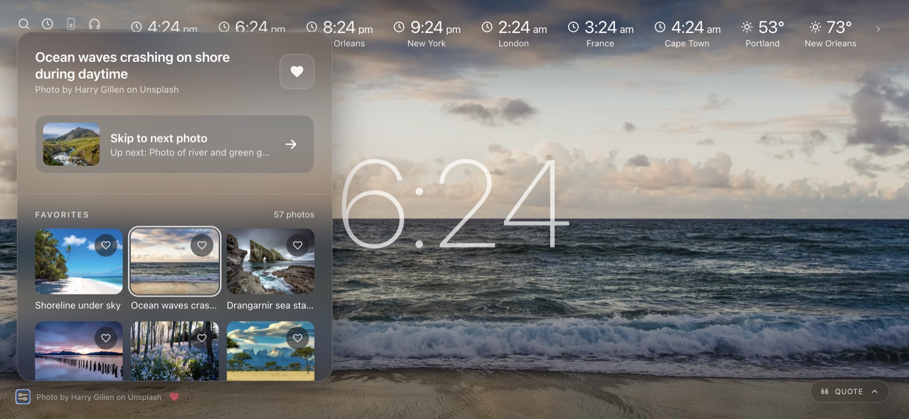

#

Porchlight greets you with a beautiful background behind your main clock, adjustable world clocks, weather, and a daily quote. When you need a quieter moment, tap the headphones and the screen opens into a full sound mixer. No timer, just focus. Layer rain, birdsong, moving water and spa music, set each one to the level you like, or let tracks play back to back as a playlist.

It runs in any browser as your new tab page, and as an iPhone/iPad app that keeps every sound on the device, so the light stays on even offline.

## What's on it

- **Clock** in the middle, with world clocks and weather along the top. The big clock (clock icon in the toolbar) and the world clocks (arrow at the end of the row) can each be hidden
- **Background photos** from Unsplash, one random photo per day from the collection in `fetch-photos.js`
- **Photo menu** (sliders icon, bottom left): the photo's title and credit, a heart to save it, *Skip to next photo* with a preview of what's next, and your favorites to pick from
- **Quote** in a glass card at the bottom right, with *next quote*; fold it down to a small pill
- **Search** (press `/`) and an optional critter
- **Sounds** (headphones icon): opens full screen. Layer nature sounds, each with its own level, and tap spa music tracks to build **Up next**, which plays them one after another (shuffle, repeat, crossfade, reorder). Save what is playing as a **mix**, and set a **sleep timer** that fades everything out
- **Alarm** (Alarm tab in Sounds): wakes you at a set time and days with a saved mix, the volume rising gently, with snooze. It rings from the page, so leave the page (or the app) open

### Music not included

One music tile, **Porch light** ("Leave the Porch Light On" by Cory Alstad), is from [Uppbeat](https://uppbeat.io/) and isn't in this repo, so it stays silent until you add your own copy as `sounds/porchlight.m4a`. To add other music, see *Your own sounds* below.

### Your own sounds

Put audio files in `sounds/custom/` and run `node custom-sounds.js`. Each one gets a tile: Uppbeat downloads (`...-main-version-...`) as spa music under **My music**, anything else as a nature sound. Names come from the file tags; to change a name, icon or group, edit `sounds/custom/custom-sounds.js` (running the script again keeps your edits). The whole `sounds/custom/` folder is in `.gitignore`, so licensed files never go into the repo. `npm run ios` copies them onto the device.

## Running it

No build. Open `index.html` in a browser, or set it as your new-tab / home page.

Favorites, hidden photos and settings are saved in the browser. `prefs.js` fills in starting favorites and settings the first time a browser opens the page.

## iPhone / iPad app

The same page, packaged as an app (Capacitor) with every sound stored on the device, so they play with no internet. Photos still come from Unsplash.

One-time setup: install **Xcode** from the Mac App Store and open it once.

To install on your phone or iPad:

1. Plug it into the Mac (on the device, tap **Trust**; on iOS 16+, turn on **Settings → Privacy & Security → Developer Mode**).
2. Run `npm run ios`. It copies the page and sounds into the app and opens Xcode.
3. In Xcode: click **App** in the left sidebar → **Signing & Capabilities** → **Team** → **Add an Account…** and sign in with your Apple ID (free).
4. Pick your device at the top of the window and press **▶ Run**.
5. First launch only: on the device, **Settings → General → VPN & Device Management** → your Apple ID → **Trust**.

With a free Apple ID the app stops opening after 7 days; plug in and press Run again to renew it. Run `npm run ios` again whenever you change the page or add sounds.

In the app, favorites, hidden photos and settings are kept on that device.

## Files

| File | What it does |
| --- | --- |
| `index.html` | The page itself |
| `fetch-photos.js` | Unsplash key and the Unsplash collection photos come from (`COLLECTION`); edit it to change what you see |
| `prefs.json` | Starting favorites, blocked photos and settings |
| `prefs-to-js.js` | Copies `prefs.json` into `prefs.js` by hand, after editing `prefs.json` yourself: `node prefs-to-js.js` |
| `build-app.js`, `capacitor.config.json`, `ios/` | The iPhone/iPad app: `npm run ios` builds and opens it in Xcode |
| `sounds/` | Nature sound loops; credits in `sounds/CREDITS.txt` |
| `custom-sounds.js` | Lists your own sounds in `sounds/custom/` (not in git) for the page |
